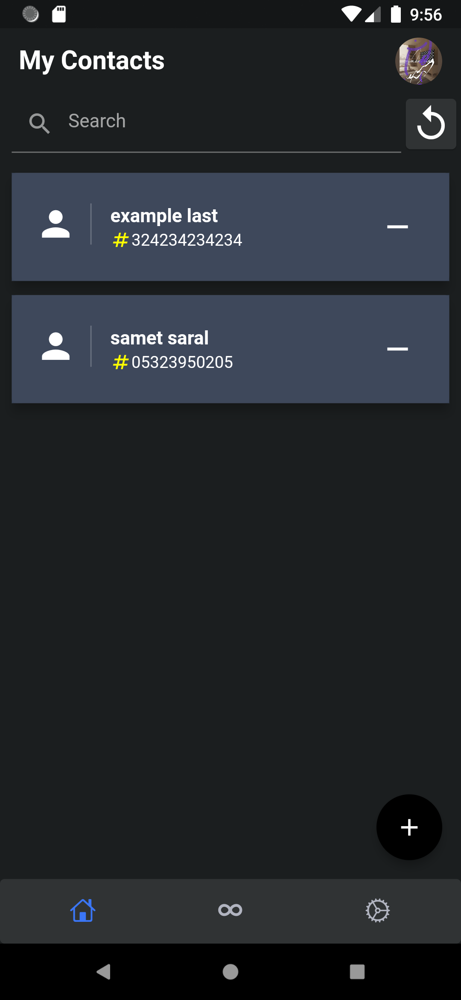
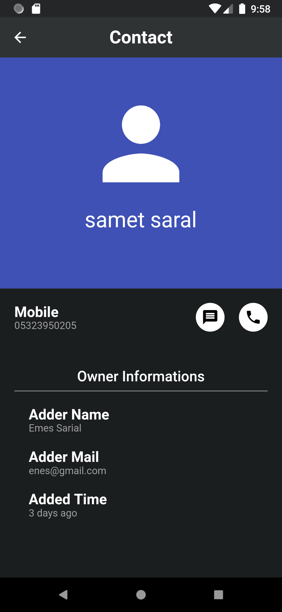
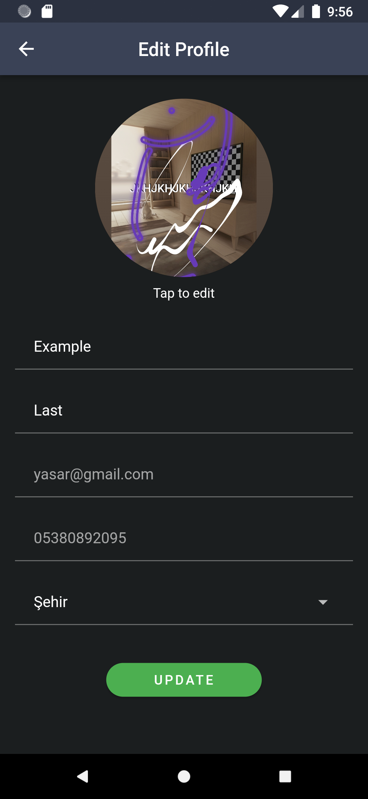
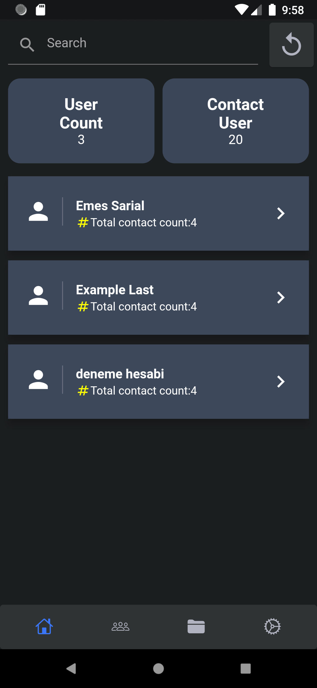
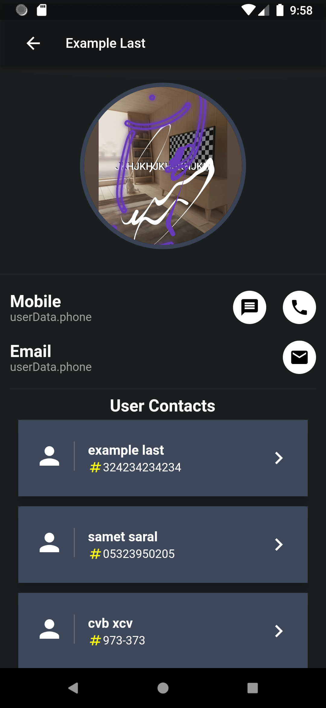
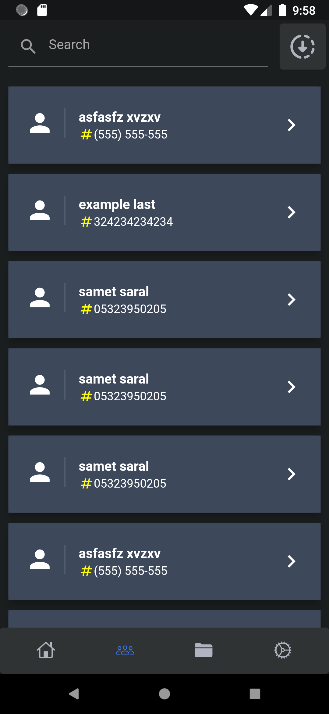

# Get Contact

A Flutter app that shows you how other people have saved your number. Each user uploads their phone contacts; the app then matches your phone number against everyone else's uploads and lists the names you are saved under ("Who saved me").

## Features

- Email/password sign-up and login (Firebase Auth)
- Reads the device address book (with permission) and syncs it to Cloud Firestore
- **My contacts**: browse the contacts you uploaded
- **Who saved me**: every contact entry across all users whose phone number matches yours
- **Admin area**: all users, all contacts, user and contact detail pages, and reports
- Export contacts to an Excel file (`.xlsx`) and open it on the device
- Profile and settings pages, English and Turkish localisation

## Stack

- Flutter (Dart ≥ 2.16), Provider
- Firebase Auth, Cloud Firestore, Storage
- `contacts_service` and `permission_handler` for the address book
- Syncfusion XlsIO for Excel export

## Project structure

```
lib/
  connections/   auth, Firestore reads/writes, contact import, Excel export
  models/        User and Contact
  provider/      Signed-in user state
  screens/       auth, user screens (my contacts, who saved me), admin screens, profile, settings
  l10n/          en / tr strings
```

## Run locally

```bash
flutter pub get
flutter run
```

Add your Firebase config files (`google-services.json`, `GoogleService-Info.plist`) first.

## Screenshots

<p>
  
  
  
</p>
<p>
  
  
  
</p>
